# RestoreProof

[](https://github.com/Atharvabagul84/restoreproof/actions/workflows/validate.yml)
[](LICENSE)


**Row counts aren't recovery.** A PostgreSQL restore can finish cleanly and still break the application: a business invariant is violated, the data is older than your recovery objective, or acknowledged writes are missing.

RestoreProof restores a backup into a disposable, network-isolated container, then proves the *application* recovered: business invariants, data freshness, a real read/write journey through the app, and exact accounting of lost writes. Every run leaves JSON, JUnit and HTML evidence.

It builds on PostgreSQL's own `pg_restore`. It is not a backup engine.

*Development history: built in a private repository from 2026-10-06 (33 commits, v0.1–v0.5); the public history starts at v1.0.0. See the [pre-release history](docs/history/release-history.md) and [changelog](CHANGELOG.md).*

<!--
Screenshot placeholder: what a failing run looks like.
1. Start Docker, then run: python -m restoreproof demo --scenario ledger-gap --output runs/ledger-gap
2. Capture the terminal (the FAIL / exit 1 line) and the ledger result in runs/ledger-gap/**/report.json
   that names the lost write-002. Keep it under ~1 MB, crop out local paths and usernames.
3. Save it as docs/assets/ledger-gap.png (or .gif) and replace this comment with:
   
-->

## Quickstart

Requires Python 3.11+ and Docker with a local Linux container engine. No cloud account or API key is needed.

```sh
python -m venv .venv && source .venv/bin/activate   # Windows: .\.venv\Scripts\Activate.ps1
python -m pip install -r requirements-lock.txt .
docker pull postgres:17.11-bookworm
python -m restoreproof demo --scenario healthy --output runs/healthy
python -m restoreproof app-demo --scenario all --output runs/chisel   # full application recovery
```

On Windows, enable long paths before cloning: `git config --global core.longpaths true`.

## How it compares

| Check | `pg_restore` exit code | Databasus / pg-backup-verify | BackupDrill | AWS Backup restore testing | **RestoreProof** |
|---|:-:|:-:|:-:|:-:|:-:|
| Restore into a disposable target | — | ✓ | ✓ | ✓ | ✓ |
| Archive checksum before restore | — | — | ✓ | — | ✓ |
| Table / row-count comparison | — | ✓ | non-empty tables | — | ✓ |
| Custom SQL checks | — | — | via custom command | via your own Lambda | ✓ declarative |
| Business invariants and freshness (RPO) policy | — | — | — | — | ✓ |
| Application journey through HTTP (read, write, tenant isolation) | — | — | — | — | ✓ |
| External write ledger (exactly which writes were lost) | — | — | — | — | ✓ |
| Evidence journal (JSON + JUnit + offline HTML) | — | report | — | job status | ✓ |
| Runs fully offline, no cloud account | ✓ | ✓ | Supabase only | AWS only | ✓ |

*"—" means not documented. Based on each project's public documentation as of 2026-10-25: [Databasus](https://github.com/databasus/databasus), [pg-backup-verify](https://github.com/pACCOU/pg-backup-verify), [BackupDrill](https://www.postgresql.org/about/news/backupdrill-open-source-supabase-postgres-backups-with-automated-restore-drills-3413/), [AWS Backup restore testing](https://docs.aws.amazon.com/aws-backup/latest/devguide/restore-testing.html). Corrections welcome.*

## How it works

```mermaid
flowchart LR
  A[Trusted contract + custom archive] --> B[Schema / size / hash preflight]
  B --> C[Owned disposable PostgreSQL target]
  C --> D[Copied-archive hash check + pg_restore]
  D --> E[Snapshot / business / freshness checks]
  E --> H[Optional external write ledger]
  H --> I[Optional HTTP application journey]
  I --> F[Ownership-checked cleanup]
  F --> G[JSON journal + JUnit]
```



Isolation and cleanup:

- **Network:** the PostgreSQL target runs with `--network none` and no published ports.
- **Privileges:** every Linux capability is dropped except the four its entrypoint needs (`CHOWN`, `FOWNER`, `SETGID`, `SETUID`), with `no-new-privileges`.
- **Resources:** CPU, memory and process limits; data on tmpfs. The root filesystem stays writable only because the archive is copied in with `docker cp`.
- **Application journey:** the Chisel containers (the bundled Next.js app and its auth/API services) run read-only with every capability dropped.
- **Cleanup:** only containers RestoreProof can prove it owns are removed, and a cleanup failure overrides an otherwise green result.

## What the scenarios show

| Scenario | What happens | Result |
|---|---|---|
| `healthy` | Snapshot, revision and freshness checks pass | `PASS` (0) |
| `stale` | Data restores correctly but is older than the policy allows | `FAIL` (1) |
| `inconsistent` | The backup faithfully restores an already broken source; a business invariant catches it | `FAIL` (1) |
| `corrupt` | A truncated archive keeps its magic bytes and checksum, but PostgreSQL can't restore it | `INCOMPLETE` (2) |
| `application` | The restored order is read through HTTP, a new order is written and read back, cross-tenant access is denied | `PASS` (0) |
| `application-broken` | Database checks pass, but the application can't find a required record | `FAIL` (1) |
| `ledger-gap` | The latest checkpoint passes, but the external ledger shows `write-002` was lost | `FAIL` (1) |
| `app-demo` | Recovers [Chisel](docs/guides/chisel-recovery.md) (Next.js + Supabase Auth) end to end, plus four controlled failures | `PASS` / `FAIL` |

Run each with `python -m restoreproof demo --scenario <name> --output runs/<name>`. Failure scenarios exit non-zero by design. Exit codes: `PASS` 0, `FAIL` 1, `INCOMPLETE` 2, `INVALID` 3 ([details](docs/guides/usage.md#outcome-contract)).

## Verify your own backup

Write a contract that names your custom-format dump, its SHA-256 and SQL checks that each return one JSON value:

```sh
python -m restoreproof verify path/to/contract.json --output runs/custom
```

See the [usage reference](docs/guides/usage.md) for the contract format, ledger and application journey options, cleanup after interruption, and tests. Contracts and archives must be trusted: this is not a sandbox for hostile dumps.

## Features

- **Application-level recovery:** separates "the database started" from "the application recovered", with freshness (RPO) and duration objectives evaluated per run.
- **Failure drills:** kill the verifier mid-restore, terminate the PostgreSQL backend, and stop the Docker daemon, then prove owned cleanup and a healthy retry ([failure drills](docs/reference/failure-drills.md)).
- **S3 backup sources:** pinned object versions with checksum and age checks; Terraform for private, encrypted, versioned storage ([S3 recovery](docs/guides/s3-recovery.md)).
- **Tested and cost-safe CI:** 245 tests (the Docker integration suites run in CI), actions pinned to commits, hosted jobs gated on verified free usage, sanitized retained evidence.

## Documentation

Start at the [documentation index](docs/README.md): [usage](docs/guides/usage.md) · [architecture](docs/ARCHITECTURE.md) · [limitations](docs/reference/limitations.md) · [offline HTML report](docs/guides/offline-report.md) · [cost policy](docs/reference/cost-policy.md) · [design decisions](docs/decisions/) · [pre-release history](docs/history/release-history.md).

## Contributing and security

See [CONTRIBUTING.md](CONTRIBUTING.md) for setup, checks and the pull-request flow, and [SECURITY.md](SECURITY.md) for the threat model and how to report a vulnerability. Changes are listed in the [changelog](CHANGELOG.md).

## Roadmap

- **RestoreProof K8s (in progress):** scheduled restore drills for CloudNativePG on Kubernetes, with RTO/RPO published as Prometheus SLIs and a fault matrix replayed in CI. It reuses this project's checks and reports.
- An arbitrary-application HTTP journey plugin, and pgBackRest backup sources.

## Limitations

Lab-scale by design: archives up to 64 MiB, one CPU and 512 MiB memory per target. The application journey is fixed to the bundled fixtures (no arbitrary-app plugin yet). Lab timings are not production MTTR or RPO measurements. See [limitations](docs/reference/limitations.md).

## License

[MIT](LICENSE) © 2026 Atharva Bagul
