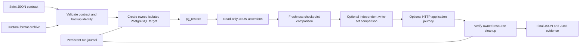

# Architecture

## Tech stack

| Area | Tool |
|---|---|
| Language | Python 3.11+ (3.12+ for the pinned local S3 lab), Pydantic contracts |
| Restore target | Docker, PostgreSQL `postgres:17.11-bookworm`, `pg_restore` |
| Application journey | Bundled Chisel v1.0.0 snapshot (Next.js), GoTrue, PostgREST 16.4 lab profile, all in one isolated network namespace |
| Backup source | Local files, or exact S3 object versions (AWS or a local emulator) |
| Evidence | JSON journal, JUnit XML, self-contained offline HTML report |
| Infrastructure | Terraform for the optional AWS S3 lab (`infra/aws/`) |
| CI | GitHub Actions: unit, PostgreSQL integration, private-daemon drill, Chisel recovery, gated S3 recovery |

## Project structure

```
restoreproof/
├ src/restoreproof/   # CLI, contracts, restore engine, ledger, journey, S3 source, reporting
│ └ chisel/assets/    # Hash-pinned Chisel snapshot + source-manifest.json (test fixture)
├ contracts/          # Example and historical verification contracts
├ schemas/            # JSON Schemas for the contracts
├ tests/              # Unit and Docker integration tests
├ infra/aws/          # Optional S3 lab (Terraform)
├ evidence/           # Recorded run evidence (immutable)
└ docs/               # Guides, reference, decisions, history
```

## Verification flow

RestoreProof verifies whether a PostgreSQL logical backup restores into a disposable target and satisfies declared correctness and freshness checks, using existing Docker and PostgreSQL tools.



## Interfaces and boundaries

- `verify CONTRACT --output DIR` validates a strict JSON contract with Pydantic and verifies one restore.
- `demo --scenario SCENARIO --output DIR` generates synthetic input and exercises the same verifier; `--help` lists database, ledger and application scenarios.
- `cleanup RUN_ID` recovers cleanup after interruption, restricted to run-owned resources.

The contract identifies the archive, expected checksum, assertions, and freshness policy. Each assertion reads one JSON value and compares it with an independent expected value. Unknown fields, malformed values, and existing database URLs are rejected.

Docker creates an owned target using approved image `postgres:17.11-bookworm`, optionally pinned by digest, with no network, published ports, or host mounts. Restore and checks access PostgreSQL locally through Docker. Record resolved image identity; tags are mutable. Contracts, archives, and images must be trusted.

## Correctness and measurement

Quiesce the demo writer while capturing expectations and the custom-format `pg_dump` archive. Keep expectations outside the archive, bound to its fixture identity; never regenerate them from restored data. Check relationships, objects, and values.

Compare the recovered freshness checkpoint with incident time and maximum age. Missing, invalid, or future checkpoints cannot establish freshness. Checkpoint age depends on clock assumptions and does not prove complete transaction recovery. An optional independent acknowledgement ledger compares exact write identities and recomputed payload hashes in a bounded, closed write set. Missing, duplicate, unexpected or altered records fail; unavailable/invalid recovered evidence is incomplete.

The optional order journey starts a loopback HTTP service after restore and checks an existing read, a new write followed by a separate read, and authentication/tenant isolation. Its repository uses the owned container only. Role provisioning does not recreate restored business data or row policies. The service is a small lab fixture, not a hosted application adapter or public production server.

Record phase durations and measurement boundaries, excluding unperformed recovery steps. Measure cleanup separately. Objectives are not achieved results.

## Outcome and lifecycle

Journal intended and created resources for crash recovery. Check ownership before deletion and verify absence afterward. Preserve reports and journal outside the target.

| Outcome | Exit | Meaning |
|---|---:|---|
| PASS | 0 | Required verification and cleanup completed successfully |
| FAIL | 1 | A completed assertion, freshness, or recovery-duration check failed |
| INCOMPLETE | 2 | Restore could not complete, or an operational failure, interruption, or cleanup failure prevents complete evidence |
| INVALID | 3 | Contract or archive preflight failed before target allocation |

Cleanup failure forces `INCOMPLETE`, including after passing verification. Preserve individual check results.

A `pg_restore` failure does not alone establish its cause. A truncated archive that passes checksum/format preflight therefore produces `INCOMPLETE`, while a checksum mismatch produces `INVALID`; neither can pass.
