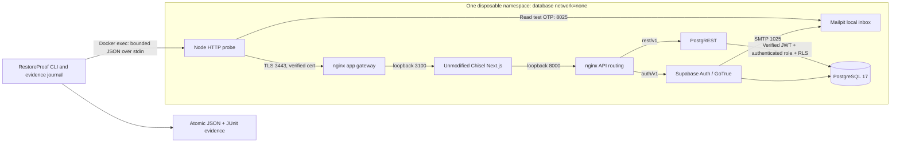

# Recover Chisel end to end

RestoreProof v0.3 restores the database behind **Chisel**, an existing team feature-brief application. The adapter uses its unchanged Next.js routes, Supabase client, SQL functions and row-level security. Its synthetic business records are created through the real application before backup. It does not replace the app with a mock API.

## Run the showcase

Prerequisites: Python 3.11+, a local Linux Docker engine, network access for the first image/npm build, and sufficient Docker memory/disk. Budget approximately 4 GB available memory and several GB of disk for the image build. Runtime services have individual memory, CPU and process limits. All actual recovery traffic remains inside the disposable database network namespace.

```sh
python -m pip install -r requirements-lock.txt .
python -m restoreproof app-demo --scenario all --output runs/chisel
```

The first run verifies 101 vendored Chisel files against their SHA-256 manifest, pulls digest-pinned dependencies and builds local app/gateway images. Later runs reuse images addressed by the asset-bundle hash. There are no live application credentials, cloud keys or external email recipients. The publishable key in this lab is a fixed, nonsecret routing identifier.

To split preparation from the measured demonstration:

```sh
python -m restoreproof prepare-app
python -m restoreproof app-demo --scenario healthy --output runs/chisel
```

Each source stack is stopped, dumped and removed before a fresh target is allocated. The target gets fresh service credentials and new TLS material. The original auth user, workspace and brief identities come from the restored database. The test signs in again using the recovered account.

## What must pass

1. A request without a session receives HTTP 401.
2. Email OTP travels from Chisel to genuine Supabase Auth to the local Mailpit SMTP sink; the code is submitted through Chisel. No fabricated login response or pre-minted user token is used.
3. Chisel establishes HTTP-only, secure cookies over TLS. The probe validates the gateway certificate explicitly; certificate checking is enabled.
4. The recovered workspace exposes the same owner UUID and email.
5. The saved brief matches a canonical content digest captured independently **before** any injected fault.
6. A new brief can be created, read back, updated and read again. A stale revision receives HTTP 409 and cannot overwrite the updated content.
7. The signed-in owner cannot read another team's workspace (HTTP 404 through the app and database RLS).
8. Sign-out clears the session, and the next protected read receives HTTP 401.
9. The measured verification finishes within the contract's small-lab duration objective, and all owned containers are removed.

## Failure matrix

| Scenario | Injection | Individual result |
|---|---|---|
| `healthy` | None | PASS / 0 |
| `missing-data` | Delete the expected source brief after recording its digest, then dump | FAIL / 1: missing saved brief |
| `incompatible-schema` | Remove the public save RPC before backup | FAIL / 1: existing data can be read, but a new write fails |
| `auth-unavailable` | Stop only the target's owned Auth container after startup | INCOMPLETE / 2: real authentication cannot be completed |
| `missing-config` | Omit the target app's required `CHISEL_APP_URL` | INCOMPLETE / 2: application refuses sign-in mutations |

`all` returns exit 0 only if all five **expected** outcomes, their specific failure causes and both source/target cleanups match. An unrelated startup or restore error cannot satisfy an expected Auth/config failure. A successful negative test does not change that recovery report to PASS. Individual JSON and JUnit reports preserve the actual failure or incomplete outcome. An interruption ends the suite after cleanup, without allocating the next scenario.

No target application migration is rerun to conceal an incompatible backup. GoTrue may check its own migration tracker on startup; the backed-up Chisel schema is restored as-is.

## Architecture



Every sidecar joins `container:<exact database ID>`. Services bind to loopback. There is no bridge network, published host port, host bind mount, Docker socket mount or external runtime egress. HTTP between components stays within that namespace. The SMTP sink contains only `.test` identities.

Services have a read-only root filesystem, dropped Linux capabilities, `no-new-privileges`, bounded `/tmp`, CPU/memory/process limits. PostgreSQL data uses a 256 MiB tmpfs. App and gateway run as their image's non-root users. The app receives no Auth signing secret or database password.

The gateway is a small **lab profile**, not the full Supabase API gateway: it accepts the fixed publishable key and forwards genuine user JWTs unchanged. It does not provide Storage, Realtime, SAML, external OAuth or platform management APIs. API anonymous access uses the `anon` database role; private access still requires Auth-issued JWTs, Chisel authorization and restored RLS policies.

## Source and restore contract

Chisel source: public repository [`Atharvabagul84/Chisel`](https://github.com/Atharvabagul84/Chisel) at v1.0.0, commit `fdb206cb24b3319328315eadaaee01eb03fda432`. Its tracked files, except its agent instruction files (`CLAUDE.md`, `AGENTS.md`), are copied byte-for-byte (104 files) under `src/restoreproof/chisel/assets/app/`; `source-manifest.json` records their digests. The bundled snapshot makes GitHub CI reproducible without another repository token. Evidence captured before the refresh records the earlier commit.

The fixed adapter accepts only that application/revision. `schemas/chisel-contract-v1.json` describes its inputs: archive path and SHA-256, expected owner/workspace/brief UUIDs, expected brief digest and a duration objective. Unknown fields, duplicate JSON keys, non-finite numbers, unsupported app revisions and invalid archives are rejected before target allocation.

```sh
python -m restoreproof verify-app path/to/contract.json --output runs/reverify
```

Archive paths resolve against the contract's directory. Contracts contain no database passwords, session tokens, OTPs or arbitrary endpoint URLs. Archives remain trusted input: the 64 MiB bound and hash checks establish identity, not safety of arbitrary database code.

Unlike the basic database adapter, Chisel restores owners and ACLs. It first provisions fixed local roles with newly generated passwords, then runs `pg_restore --single-transaction --exit-on-error` after verifying the copied archive hash. This preserves the private security-definer functions and direct-table write restrictions.

## Evidence and cleanup

Each scenario creates a source report, a pre-fault expectation file, a custom-format dump and a strict contract. Each target has a separate run ID, component IDs, observed image IDs, per-phase timing, application checks, JSON report and JUnit file. Journals are written before allocation and after resource creation. The suite summary links the individual results.

Raw backups are deliberately gitignored and excluded from CI artifacts; even synthetic backups contain auth session material. Reports omit HTTP bodies, OTPs, cookies, passwords and private keys. CI uploads only curated reports, JUnit, expectations and the suite summary.

```sh
python -m restoreproof cleanup-app <32-character-source-or-target-run-id>
```

Cleanup verifies exact IDs, names, labels and namespace relationships before removing services, then removes the owned database. A foreign label, renamed resource, replaced ID, daemon outage or ambiguous ownership returns INCOMPLETE. It never runs a global prune. If a database was manually removed while sidecars remain, ownership may need manual inspection; the tool refuses to guess.

## Practical limits

This proves a small, quiescent logical-backup recovery for Chisel's team collaboration API. It does not prove physical restore/PITR, large dataset performance, recovery under concurrent production writes, external email delivery, browser rendering or localStorage recovery, AI generation, external OAuth, infrastructure disaster recovery or production RTO/RPO. AI keys are absent. Source capture and image preparation are outside the measured target-recovery window; cleanup is timed separately. A failed attempt is not a successful recovery time.

The full test suite keeps the existing ledger and interrupted-restore drills. This app adapter complements those checks; it does not replace their distinct data-loss and interruption claims.

## Primary references

- [Supabase self-hosting](https://supabase.com/docs/guides/self-hosting/docker) and [email OTP authentication](https://supabase.com/docs/guides/auth/auth-email-passwordless).
- [Auth external URL change](https://supabase.com/changelog/47093-self-hosted-supabase-api-external-url-to-include-auth-v1): the lab includes `/auth/v1` in the configured external URL.
- [Supabase gateway change](https://supabase.com/changelog/48048-self-hosted-supabase-envoy-becomes-the-default-api-gateway-b): the current full stack uses Envoy; this intentionally smaller lab uses its own reviewed nginx routes.
- [Mailpit API](https://mailpit.axllent.org/docs/api-v1/) for retrieving local test mail.
- [PostgREST retry issue](https://github.com/PostgREST/postgrest/issues/3673) and [upstream changelog](https://github.com/PostgREST/postgrest/blob/main/CHANGELOG.md) for the dependency incompatibility discovered by the stale-write test.
