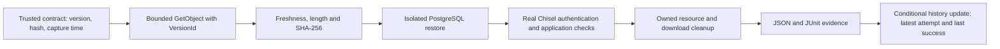

# Exact-version S3 recovery

RestoreProof v0.4 retrieves a specific backup version, checks its capture age and SHA-256, then runs the existing real Chisel recovery journey. A successful download or a running PostgreSQL container alone cannot produce PASS.

## Reproduce the complete free local demonstration

The pinned lab environment requires Python 3.12+ and a local Linux Docker engine. The core package supports Python 3.11+, but the lab lock includes a dependency requiring 3.12. From the repository root:

```sh
python -m venv .venv
# Activate .venv using your shell's activation command.
python -m pip install -r requirements-lab-lock.txt '.[s3-lab]'
python -m restoreproof s3-demo --output runs/s3-demo
```

The first command builds the pinned Chisel image, creates synthetic records through the actual application, captures the source, and starts Moto on a random loopback port with dummy credentials. It uploads the archive, uploads a newer incorrect object at the same key, and verifies the original version. It then exercises all five storage failures. Source and recovery containers, downloaded files and the owned local S3 bucket are cleaned. The source fixture and JSON evidence remain under the ignored output directory for inspection.

The suite is successful when the healthy case passes and all negative cases fail for their intended reasons. A suite PASS does **not** mean every recovery attempt succeeded.

The printed suite JSON includes the full history and its `summary_path`. To derive that history again, pass the corresponding suite's `drills` directory to `python -m restoreproof s3-history --output <that-directory>`. For individual `verify-s3 --output runs/s3` attempts, use `s3-history --output runs/s3`.



## Trust and backup identity

Use a trusted, reviewed contract. RestoreProof does not authenticate an arbitrary backup producer or infer a capture time from S3 metadata. The producer must capture a quiescent source or otherwise establish a consistent backup boundary, calculate SHA-256 from those archive bytes, and preserve the capture timestamp and independent application expectations.

Start with the `contract.json` emitted by a successful Chisel source capture. Keep all application identity, expectations and restore bounds. Replace only its `backup` object with:

```json
{
  "bucket": "your-private-versioned-bucket",
  "key": "backups/chisel/source.dump",
  "version_id": "VERSION_RETURNED_BY_THE_SUCCESSFUL_UPLOAD",
  "sha256": "LOWERCASE_SHA256_OF_THE_CAPTURED_ARCHIVE",
  "expected_bucket_owner": "123456789012",
  "captured_at": "2026-10-07T00:00:00+00:00",
  "max_age_seconds": 86400
}
```

This fragment is explanatory, not an executable fixture; replace the placeholders. The full machine-readable schema is [s3-contract.schema.json](../../schemas/s3-contract.schema.json). A null/unversioned ID, naive timestamp, duplicate JSON keys, non-finite values or oversized contract is rejected. Re-uploading old data must not reset `captured_at`.

An authorized **producer** uploads the backup and records the returned version ID. The recovery role intentionally cannot upload or delete backups. Keep source/producer permissions separate from recovery permissions. The contract pins one version; it does not mean "latest" and does not rotate itself when a producer creates another backup. Update the reviewed contract after each new capture. Without a refreshed contract, a scheduled drill correctly starts failing the freshness policy.

## Individual verification commands

For an already running loopback emulator:

```sh
python -m restoreproof verify-s3 path/to/contract.json \
  --mode local --endpoint http://127.0.0.1:5000 --region us-east-1 \
  --output runs/s3 --summary runs/current.json --publish
```

For AWS, first satisfy the [free-only policy](../reference/cost-policy.md) and [deployment runbook](../../infra/aws/README.md). Use the configured GitHub OIDC role where supported, or an independently authorized temporary local-development session for a local live-S3 test. The CLI requires all three temporary AWS environment variables plus `RESTOREPROOF_AWS_FREE_VERIFIED=true`; never place credentials in contracts, command arguments or Git. Using a broader project session does not prove the proposed recovery role's least-privilege policy. This account's OIDC restriction is documented in [the compatibility finding](../history/aws-account-compatibility.md).

```sh
python -m restoreproof prepare-app
python -m restoreproof verify-s3 contracts/s3-chisel.json \
  --mode aws --region ap-southeast-2 --output runs/s3 \
  --summary runs/current.json --publish
```

Local mode requires a literal loopback HTTP endpoint and uses explicit dummy credentials. AWS mode refuses custom endpoints, requires an official regional HTTPS endpoint, and does not discover long-lived credentials. Endpoint redirects are refused in both modes. Preparing images before obtaining the short-lived AWS session avoids spending credential lifetime on builds.

## Failure contract

| Case | Expected result | Evidence |
|---|---|---|
| Healthy original version after newer upload | PASS / 0 | Exact requested and returned version, matching hash, complete Chisel checks, cleanup PASS |
| Missing object/version | INCOMPLETE / 2 | `missing-object` when S3 discloses absence; no target allocation |
| Denied access | INCOMPLETE / 2 | `access-denied`; no upstream credentials or response body exposed |
| Wrong SHA-256 | FAIL / 1 | `checksum-mismatch`; verified archive never published to the restore step |
| Stale capture | FAIL / 1 | `stale-backup`; checked before downloading or allocating |
| Interrupted download | INCOMPLETE / 2 | `download-interrupted`; partial file removed, no target allocation |

Without `ListBucket`, real AWS may return 403 for an absent object. RestoreProof reports the observed access failure; it cannot honestly distinguish hidden absence from denied access. No broad listing permission is added merely to improve the error label. [AWS GetObject behavior](https://docs.aws.amazon.com/boto3/latest/reference/services/s3/client/get_object.html).

The archive is bounded to 64 MiB, streamed in 64 KiB chunks, checked against declared length, flushed and atomically renamed only after verification. The SDK has a 3-second connection timeout, 10-second read timeout and one total request attempt. A monotonic 60-second download budget is checked between reads; a blocked read can extend this by up to the configured read timeout. These are small-demo limits, not a general multi-terabyte backup transport.

## Application acceptance and measurement

The existing Chisel checks authenticate through GoTrue, recover the expected saved brief, create and update a new brief, reject a stale update, enforce tenant isolation and sign out. See the [Chisel architecture](chisel-recovery.md). Every required check must appear exactly once with PASS, the child exit code must be zero, and both application and download cleanup must succeed.

Reports retain exact backup identity, capture age, retrieved bytes, hash, phase durations, implementation package version and a digest of the Python implementation plus Chisel source manifest. `total_seconds` includes retrieval, verification, cleanup and any image preparation inside the attempt. This synthetic recovery measurement is not production RTO or RPO.

## History and publication

Local journals start as INCOMPLETE before external work. `s3-history` derives the latest attempt and last successful cleaned recovery from those journals. The default recent window is 30; at most 100 may be requested, and more than 1,000 root journals requires archiving older run directories. Failed or out-of-order attempts cannot replace a newer success.

With `--publish`, a unique report is written under `evidence/chisel/runs/<run-id>.json`, then `evidence/chisel/history.json` is updated using its ETag as a compare-and-swap condition. Initial history is conditionally created, so bootstrap does not need `ListBucket` or mistake AccessDenied for absence. Three concurrency conflicts leave publication INCOMPLETE and retain the local report.

The stable CLI summary distinguishes verification and publication status. A successful verification with failed publication returns overall INCOMPLETE, exit 2. Re-running verification produces a new run ID; uploading the same run report again is intentionally refused by its create-only write. Local evidence remains the recovery authority when publication fails. This is a bounded operational index, not a tamper-proof audit ledger: the role can overwrite objects within its evidence prefix, and bucket lifecycle eventually expires evidence versions.

## Scheduling and interruption

The [recovery workflow](../../.github/workflows/recover-s3.yml) has an opt-in Monday 04:17 UTC schedule. It uses one non-cancelling concurrency group for AWS attempts and retains curated Actions reports for one day. Scheduling stays disabled until all gates in the deployment runbook are satisfied. GitHub scheduling is best-effort, not a recovery SLA. No local OS task is installed automatically.

An uncatchable process/host termination may prevent cleanup. The initial journal remains INCOMPLETE; do not present it as success. Find the nested application's run ID and use the existing `cleanup-app` command described in the Chisel runbook to reconcile only its labeled resources. Inspect the owned S3 run directory before removing any surviving `backup.dump` or `.s3-download-*` file. Never use broad Docker prune or bucket deletion as recovery cleanup. Retained source fixtures are intentional and separate from downloaded target archives.

## Evidence limits

Moto tests exercise real HTTP requests, version selection, failure propagation and history updates. They do not validate AWS IAM, OIDC trust, encryption enforcement, object durability or cross-region disaster recovery. Moto's policy behavior differs from AWS, including the action used for its preliminary versioned-object deny check. The interrupted-download case uses a real loopback HTTP connection that closes mid-body. Terraform mock tests validate planned settings, not applied cloud resources. See the separate [v0.4 validation record](../history/validation-v04.md).

The later [live S3 validation](../history/validation-aws-live.md) confirms actual bucket settings, exact-version retrieval, application verification and evidence publication. Its denied-access case uses S3's ExpectedBucketOwner mismatch; its interrupted-download case closes an actual S3 response after 4,096 bytes. Those controlled boundaries do not establish scoped IAM enforcement, an AWS outage, GitHub federation or production RTO/RPO.
